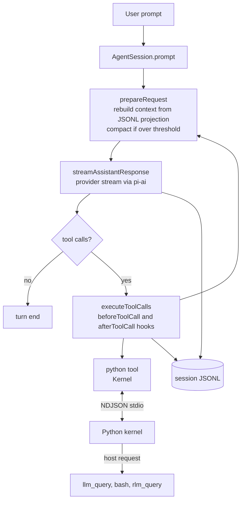

# Raga architecture

Raga is a coding harness for long tasks such as refactors, model training runs, and ports of legacy codebases. It keeps working until a goal or a metric is met, and it is built to get better at a task each time the task repeats. No measurement has shown that improvement yet. Raga is a fork of [pi](https://github.com/badlogic/pi-mono). This document explains how the pi base works and where raga's own layers attach to it. [PROGRESS.md](PROGRESS.md) tracks which of those layers exist today.

The repository still uses pi's names: the `@earendil-works/pi-*` packages and the `pi` binary. User configuration, credentials, and models stay in `~/.pi/agent/`. Project configuration moved from `.pi` to `.raga`, and `pi instance migrate --trust` copies an existing `.pi` directory. Package and executable renaming is separate.

## Overview

Raga has three layers.

1. The pi base is a TypeScript monorepo. It provides the LLM provider layer, the agent turn loop, sessions, tools, extensions, and the terminal UI.
2. The RLM runtime is a persistent Python REPL kernel owned by each session. The model works inside the kernel. Large inputs and history live in Python variables instead of the context window. Python code can call sub-LLMs and recursive sub-agents. This follows the Recursive Language Model design from [Zhang et al.](https://arxiv.org/abs/2512.24601) and the [Prime Agent](https://www.primeintellect.ai/blog/prime-agent) harness.
3. The adaptive layer gives each project instance its own Git-versioned harness of instructions, extensions, skills, lessons, and child specs, plus separate memory and session state. A retrieval gate selects applicable memory. An evidence-driven refinement loop proposes harness revisions and measures them with real solver runs and an external evaluator. The goal and metric loop is still planned.

The TypeScript host is the stable core and is not editable by the agent. Agents propose changes to harness artifacts in candidate checkouts. A trusted supervisor commits each candidate, measures the exact commit, and activates it only with approval and matching evidence. Running sessions stay on their pinned revision, and executable changes reach new sessions with fresh kernels and host processes. Host extensions require explicit approval because they execute with host permissions. Git rollback changes subsequent execution, not live objects, project files, or external side effects. [INSTANCE-PLAN.md](INSTANCE-PLAN.md) shows the `pi instance` workflow and describes each milestone, and [PROGRESS.md](PROGRESS.md) records what is verified.

## Key concepts

**Session.** A session is one append-only JSONL file under `~/.pi/agent/sessions/`, or under `.raga/state/sessions/` for an instance session. Every entry has an `id` and a `parentId`, so one file holds a tree of branches. The JSONL tree is the source of truth. The in-memory transcript is rebuilt from it before every model request.

**Projection.** `buildSessionProjection` in `packages/coding-agent/src/core/session-manager.ts` turns the current branch into the messages the model sees. It applies compaction summaries and context edits on the way.

**Tool.** A tool is a `ToolDefinition` with a TypeBox parameter schema and an `execute` function. Built-in tools are `read`, `bash`, `edit`, `write`, `grep`, `find`, and `ls`.

**Extension.** An extension is a TypeScript module that hooks session events, registers tools and commands, and rewrites context. Raga uses extensions for optional features, not for the RLM runtime. Section "Why the RLM runtime is native" explains why.

**Kernel.** The kernel is a Python process that speaks newline-delimited JSON over stdin and stdout. It keeps one namespace across calls and supports top-level `await`. The host owns the kernel's whole lifecycle.

**Host request.** A host request is a call from Python code back into the TypeScript host, such as `llm_query` or `bash`. The host answers it while the cell that made the call is still running.

**Instance.** An instance is a project's `.raga/` directory. It binds one project path to a harness repository, the active revision, and instance state. Running `pi` inside the project, or `pi instance run`, starts an instance session.

**Harness revision.** A harness revision is one commit in `.raga/harness/`. Accepted revisions are the only content that a session loads and that `pi instance fork` copies. A session records its revision in a `raga-instance-pin` entry and keeps it until it ends.

## How a turn works

The user prompt enters `AgentSession`, which wraps the generic loop from `packages/agent`. Each turn rebuilds the context from the session file, streams one model response, runs the tool calls in that response, and persists every message.

In RLM mode `python` is the only model tool. The model reads files, runs commands, and edits code by writing Python that calls `read`, `bash`, and `edit` as functions. The kernel manager starts the kernel and runs a bootstrap cell before the model first needs it. The bootstrap cell binds `context`, the tool functions, `llm_query`, `llm_batch`, `rlm_query`, and the loaded skills. The model never sets up the environment itself.

Tool output reaches the model shortened to a head and a tail. The full output stays in the kernel, so the model can search or slice it with Python instead of reading it again.

## Where things live

| Path | What it owns |
|---|---|
| `packages/ai` | Provider-agnostic LLM API, model catalog, auth. `completeSimple` and `streamSimple` make model calls. |
| `packages/agent` | The turn loop (`runLoop` in `src/agent-loop.ts`) and the `Agent` state class. |
| `packages/coding-agent/src/core/agent-session.ts` | `AgentSession`. Persistence, compaction triggers, the tool registry, extension hooks, and system prompt rebuilds. |
| `packages/coding-agent/src/core/session-manager.ts` | `SessionManager`. The JSONL tree, branching, forking, and `buildSessionProjection`. |
| `packages/coding-agent/src/core/tools/` | Built-in tools. `createAllToolDefinitions` in `index.ts` registers them. |
| `packages/coding-agent/src/core/system-prompt.ts` | `buildSystemPrompt`. Sections for tools, rules, context files, and skills. |
| `packages/coding-agent/src/core/compaction/` | Compaction. `compact` summarizes old entries and appends a compaction entry. |
| `packages/coding-agent/src/core/model-runtime.ts` | `ModelRuntime`. Session-aware model calls with the user's auth and `models.json`. |
| `packages/coding-agent/src/core/sdk.ts` | `createAgentSession`. Builds a session in code. Raga uses it for child sessions. |
| `packages/coding-agent/src/core/rlm/` | The TypeScript side of the RLM runtime. `Kernel` in `kernel.ts` runs one kernel process. [RLM.md](RLM.md) lists every file. |
| `packages/coding-agent/python/raga_rlm/` | The Python kernel (`raga_rlm.repl`) and the functions the model calls. |
| `packages/coding-agent/src/core/instances/` | Instances. `store.ts` owns revisions and activation, `session.ts` pins sessions, `sandbox.ts` runs bubblewrap, `workspaces.ts` owns child checkouts and integration, `memory.ts` stores and retrieves memory, `skills.ts` validates learned skills, `refinement.ts` and `model-refinement.ts` run Propose-Probe-Compose, `automation.ts` and `checkpoint.ts` run opt-in checkpoint refinement, and `no-mistakes.ts` manages the pinned backend. |
| `packages/coding-agent/src/cli/instance-command.ts` | The `pi instance` commands. |
| `packages/coding-agent/bundled-skills/` | The default harness that `pi instance init` copies. `bundle.json` pins its sources and checksums. `scripts/raga-sync-skills.mjs` regenerates it. |
| `bench/rlm/instances/` | The transfer benchmark and the deterministic two-project scenario. |
| `packages/codemode`, `packages/durable`, `packages/env`, `packages/mcp`, `packages/chord`, `packages/tui`, `packages/telemetry` | Pi packages that raga keeps as they are. |
| `docs/` | Raga docs. Pi's own docs are in `packages/coding-agent/docs/`. |

## Why the RLM runtime is native

An earlier attempt ran RLM as a pi extension. It gave the model a `python` tool with `llm_query`, `llm_batch`, and `tool()`. That covered the basic REPL. The rest of the runtime needs hooks that the extension API does not have.

| Need | What the extension API allows |
|---|---|
| The kernel follows the session through start, fork, resume, and shutdown | Only `session_shutdown` |
| History and large inputs live in the kernel, and compaction keeps a pointer to them | Only `context` rewrites and `session_before_compact` |
| `python` is the only tool and the system prompt is built around it | A full prompt replacement once per run, through `before_agent_start` |
| Child sessions with a depth limit, a budget, and usage rolled up to the parent | Tools and events cannot create a child `AgentSession` through the API |
| `python` is the only model tool, and Python still calls `bash`, `read`, `edit`, and `write` | `ctx.executeTool` reaches only tools that are active and visible to the model, so hiding the built-ins also makes them uncallable |

Raga puts the runtime in new directories and adds a few narrow hooks to `AgentSession`. That keeps merges from upstream pi small while the fork still tracks it.

## Why the kernel is not Jupyter

The kernel is a small custom Python process, the same design Prime Agent uses. It needs no ZeroMQ, no `ipykernel`, and no Jupyter protocol. The protocol has one request type per action (`execute`, `interrupt`, `host_reply`, `snapshot`, and `restore`) and one event type per output (`stdout`, `stderr`, `result`, `error`, `host_request`, and `done`). A reader thread answers host replies and interrupts while a cell runs, so Python code can `await` a host request without blocking the kernel.

## Why accepted revisions and instance state are separate

An instance keeps two kinds of data. Accepted harness revisions are reviewed, immutable, and shareable. Sessions, kernel snapshots, child checkouts, memory, backend state, and evidence are transient and belong to one project. Keeping the second kind out of the harness repository means a fork or a rollback cannot carry credentials, raw observations, or live kernel state, and a session can always reload exactly the revision it started on.

`createAgentSession` resolves the pin first. When it finds an instance, it reads settings from the pinned `settings.json`, loads resources only from the pinned checkout, stores the session under `.raga/state/sessions/`, forces RLM mode, and starts the kernel in bubblewrap with `python` as the only model tool. Credentials still come from `~/.pi/agent/auth.json`. A child opens the same pin instead of borrowing its parent's loaders, and a writing child works in its own checkout of a project snapshot. Only the supervisor merges child changes, in a separate integration checkout that runs your check command on the combined result.

Revision changes go through one gate. A candidate becomes active only when supervisor evidence compares it with the current active revision, the caller names that active revision, and the user approves. Opt-in policy approval exists for held-out evidence, but it never covers `extensions/` or `settings.json`.

## Gotchas

- `packages/codemode` looks like a REPL but is not one. It starts a fresh QuickJS worker for every call, and no state survives between calls.
- The bash tool spawns a new shell for every call. Shell state such as `cd` and exported variables does not persist between calls.
- System prompt changes reach the model as patch messages inside the transcript, not as a new system prompt. `diffSystemPromptSections` in `system-prompt.ts` builds them.
- Pi's `packages/*/CHANGELOG.md` files and `vX.Y.Z` tags belong to upstream pi. Raga's version and changelog are separate. See [Versioning](#versioning).
- An instance session needs Linux with a working `bwrap`. On other platforms its kernel does not start.
- Running `pi` anywhere inside a project with `.raga/instance.json` starts an instance session, not an ordinary pi session.

## Versioning

Raga's version is the newest annotated `raga-vX.Y.Z` tag behind `HEAD`. `scripts/raga-release.mjs` builds the root `CHANGELOG.md` from the conventional commit headers on the first-parent history since that tag. Upstream pi commits never become entries. A merge from upstream becomes one line under **Upstream**. [RELEASING.md](RELEASING.md) has the commands.
