# Diagram examples

Every example renders with the Pele version raga pins. Copy the closest one, then change it. The types marked beta are Pele and Mermaid extensions that many models have not seen, so start from the example instead of from memory.

Inside an artifact, put each diagram in `<pre class="mermaid">...</pre>` and escape `<`, `>`, and `&` as `&lt;`, `&gt;`, and `&amp;`.

## Flowchart

Keyword `flowchart LR`. Processes, decisions, pipelines. Audience: both.

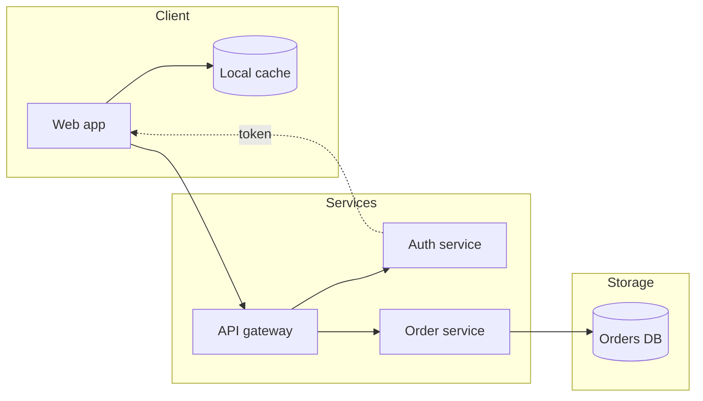

## Sequence

Keyword `sequenceDiagram`. Requests between services or people over time. Audience: developers.

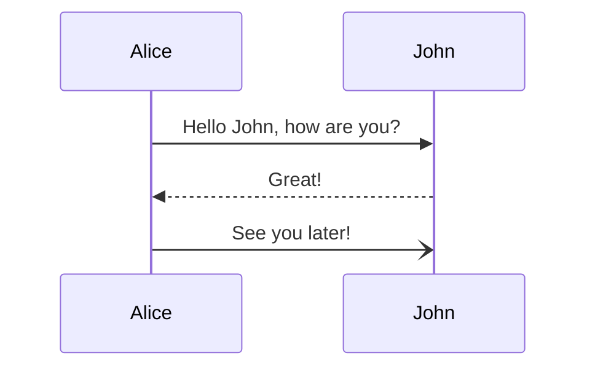

## Class

Keyword `classDiagram`. Types, interfaces, and their relations. Audience: developers.

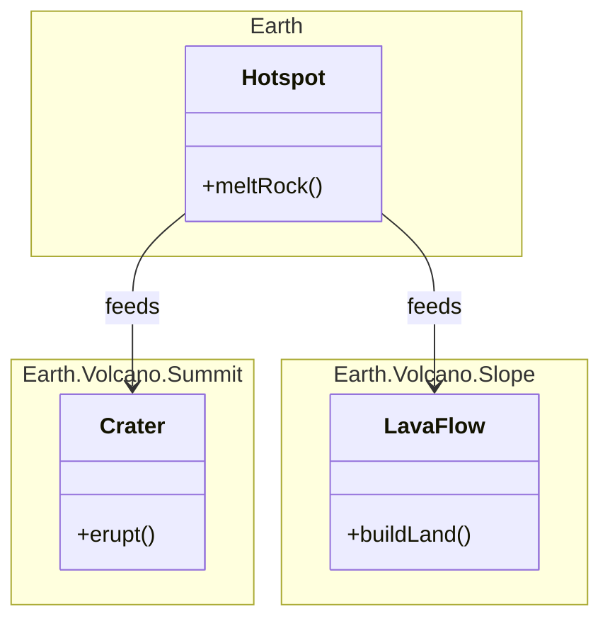

## State

Keyword `stateDiagram-v2`. Lifecycles and state machines. Audience: developers.

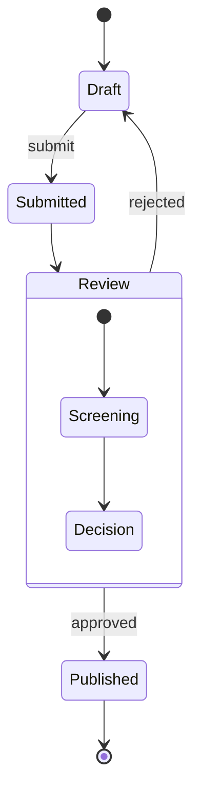

## Entity relationship

Keyword `erDiagram`. Database tables and relations. Audience: developers.

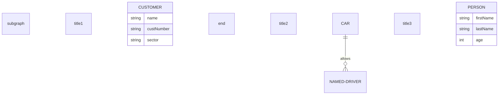

## C4

Keyword `C4Context`. System context, containers, components. Audience: both.

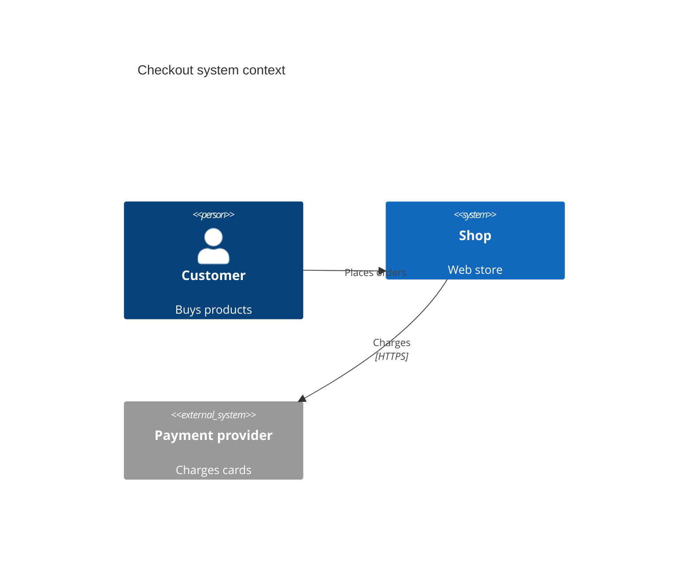

## Architecture

Keyword `architecture-beta`. Cloud and service topology with groups and icons. Audience: both.

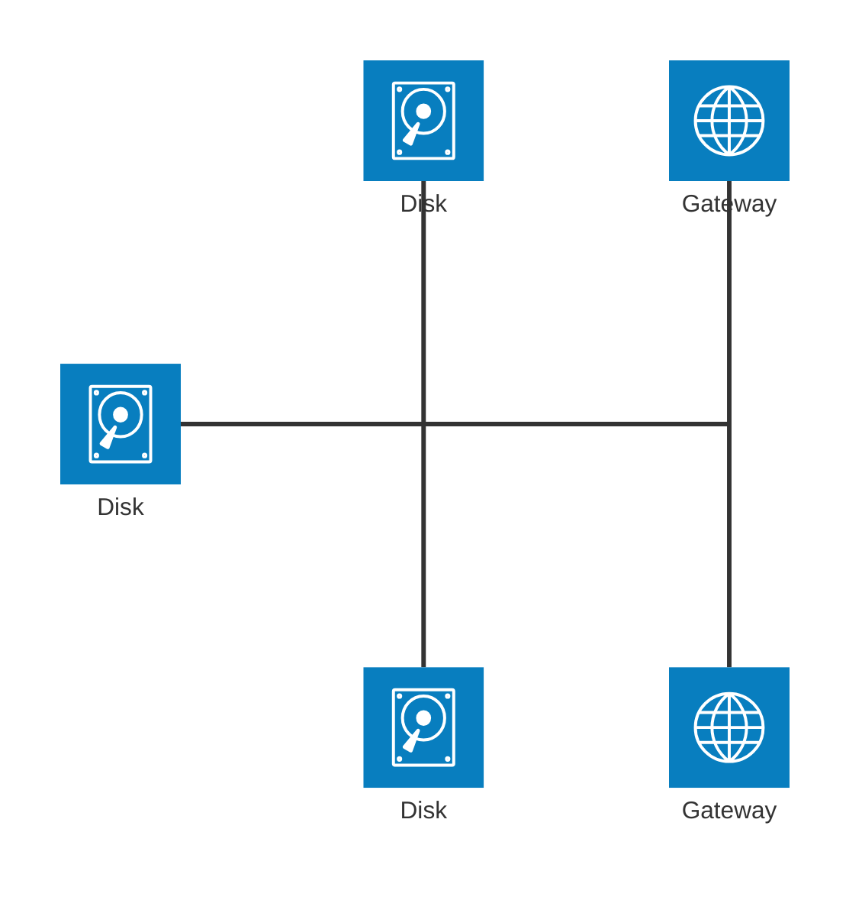

## Block

Keyword `block`. Layered or grid layouts of components. Audience: developers.

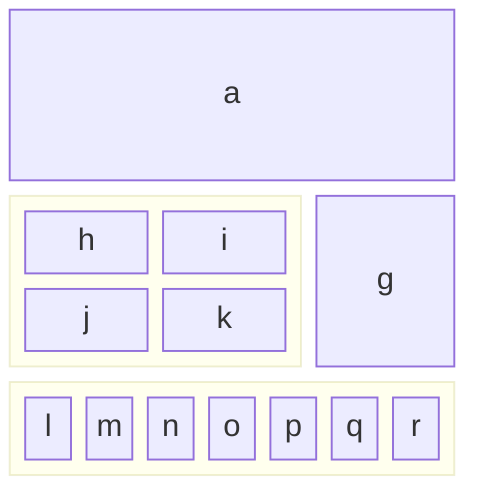

## Packet

Keyword `packet`. Bit and byte layouts of protocols or file formats. Audience: developers.

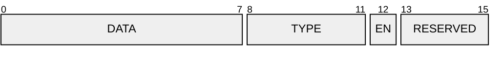

## Git graph

Keyword `gitGraph`. Branching and release strategy. Audience: developers.

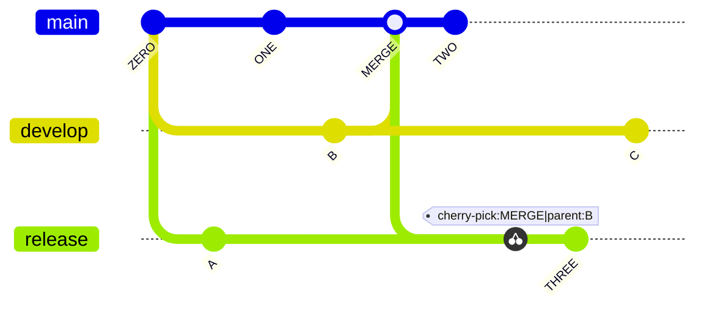

## Agentflow

Keyword `agentflow-beta`. AI agent and tool-call workflows. Audience: developers.

```mermaid
agentflow-beta TB
  flow intake["Intake"]
    receive["Receive request"]@{ shape: input }
  end

  flow processing["Processing"]
    validate["Validate"]@{ shape: task }
    enrich["Enrich"]@{ shape: task }
    validate --> enrich
  end
  processing@{ view: "collapsed" }

  flow output["Output"]
    publish["Publish"]@{ shape: action }
  end

  receive --> validate
  enrich --> publish
```

## Railroad

Keyword `railroad-ebnf-beta`. Grammar and syntax rules. Audience: developers.

```mermaid
railroad-ebnf-beta
title "Arithmetic Expression Grammar"

expression = term ( ( "+" | "-" ) term )* ;
term = factor ( ( "*" | "/" ) factor )* ;
factor = number | "(" expression ")" ;
number = digit+ ;
digit = "0" | "1" | "2" | "3" | "4" | "5" | "6" | "7" | "8" | "9" ;
```

## Event modeling

Keyword `eventmodeling`. Commands, events, and views of an event-driven system. Audience: developers.

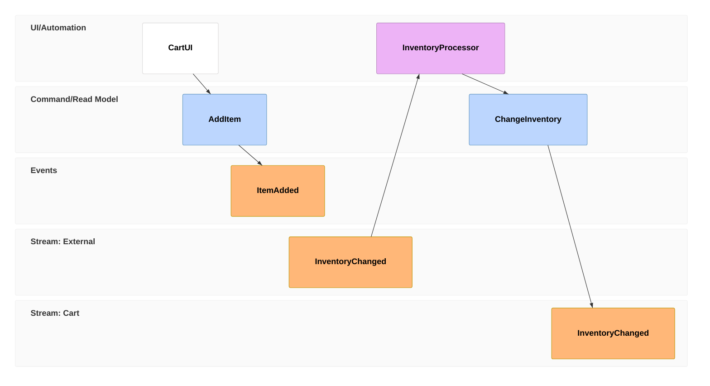

## Requirement

Keyword `requirementDiagram`. Requirements and what satisfies or verifies them. Audience: both.

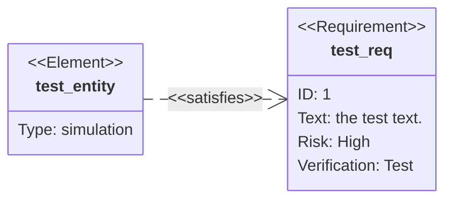

## Gantt

Keyword `gantt`. Schedules with tasks and dependencies. Audience: clients.

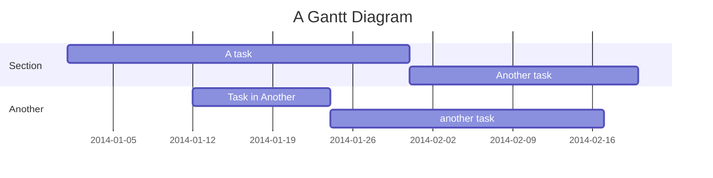

## Timeline

Keyword `timeline`. Milestones and history. Audience: clients.

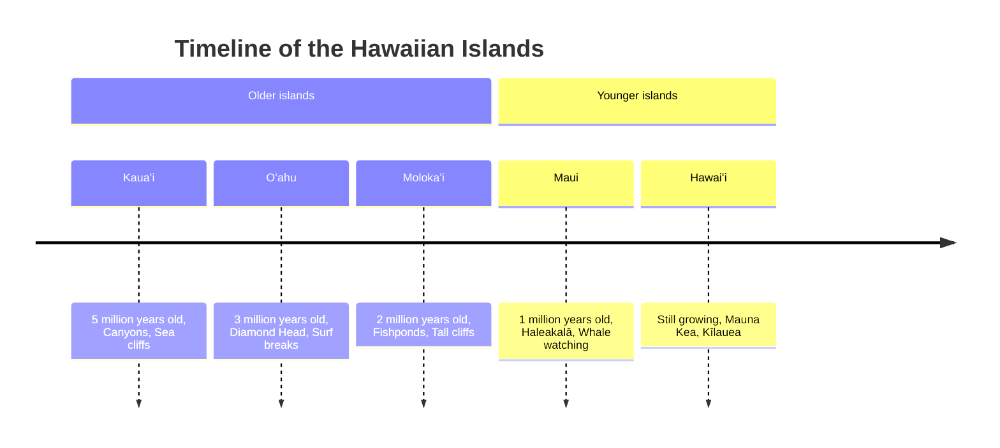

## Kanban

Keyword `kanban`. Work status by column. Audience: clients.

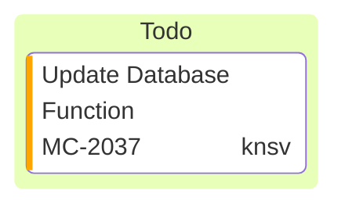

## User journey

Keyword `journey`. Steps a user takes, with satisfaction scores. Audience: clients.

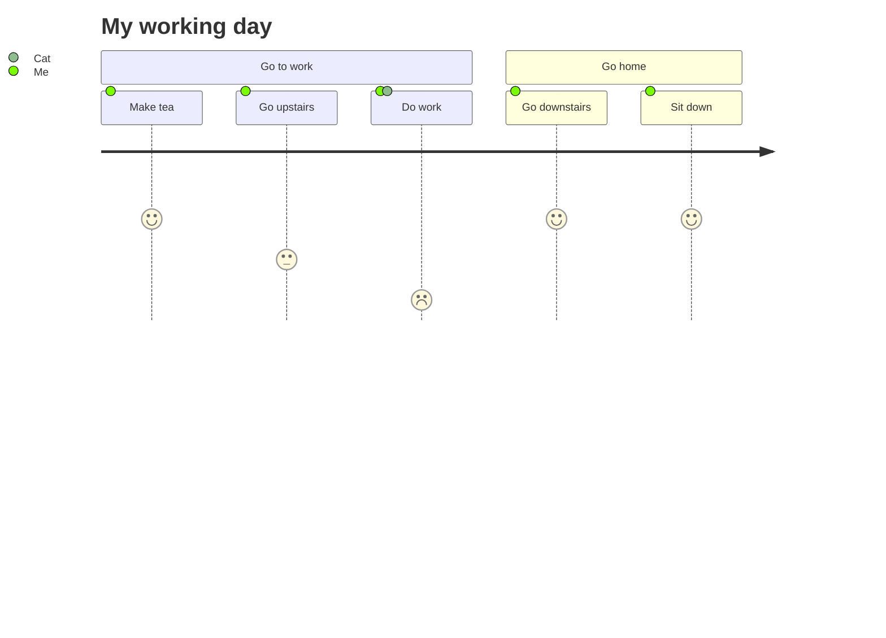

## Mindmap

Keyword `mindmap`. Topics and ideas branching from one center. Audience: clients.

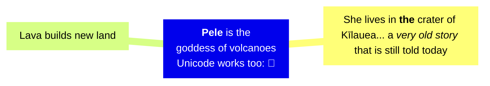

## Use case

Keyword `usecase-beta`. Actors and what they can do. Audience: both.

```mermaid
---
config:
  theme: default
  look: classic
  layout: dagre
---
usecase-beta
direction LR
actor Customer
actor Support
systemBoundary Storefront
  Browse("Browse catalog")
  Checkout("Checkout")
end
systemBoundary Fulfilment
  Track("Track delivery")
end
Customer --> Browse
Customer --> Checkout
Customer --> Track
Support --> Track
Checkout ..> : include Browse
```

## Swimlane

Keyword `swimlane-beta`. A process split by team or role. Audience: clients.

```mermaid
swimlane-beta LR
  subgraph Applicant
    apply[Submit application]
    sign[Sign agreement]
  end

  subgraph Reviewer
    screen[Screen application]
    decide{Approved?}
  end

  subgraph System
    create[Create account]
    notify[Send welcome email]
  end

  apply -->|Application received| screen
  screen --> decide
  decide -->|Approved| create --> notify --> sign
  decide -->|Needs changes| apply
```

## Tree view

Keyword `treeView-beta`. File trees and hierarchies. Audience: developers.

```mermaid
treeView-beta
    my-project/
        src/
            App.tsx :::highlight icon(logos:react) ## main component
            index.js ## entry point
        .env ## environment variables
        Dockerfile
        package.json
```

## Pie

Keyword `pie`. Parts of a whole, at most six slices. Audience: clients.

```mermaid
pie title Fish caught by the crew
    "ʻAhi" : 386
    "Mahimahi" : 85
    "Ono" : 15
```

## XY chart

Keyword `xychart`. Bar and line charts over a series. Audience: clients.

```mermaid
---
config:
    xyChart:
        showDataLabel: true
        showDataLabelOutsideBar: true
---
xychart
    title "Animals seen in reef survey of 2025"
    x-axis [turtles, eels, tangs, wrasses, "parrot fish", other]
    y-axis "Number of Animals" 0 --> 30
    bar [12,2,20,25,17,24]
```

## Quadrant chart

Keyword `quadrantChart`. Two-axis prioritization, such as effort against impact. Audience: clients.

```mermaid
quadrantChart
    title Reach and engagement of campaigns
    x-axis Low Reach --> High Reach
    y-axis Low Engagement --> High Engagement
    quadrant-1 We should expand
    quadrant-2 Need to promote
    quadrant-3 Re-evaluate
    quadrant-4 May be improved
    Campaign A: [0.3, 0.6]
    Campaign B: [0.45, 0.23]
    Campaign C: [0.57, 0.69]
    Campaign D: [0.78, 0.34]
    Campaign E: [0.40, 0.34]
    Campaign F: [0.35, 0.78]
```

## Sankey

Keyword `sankey`. Flows of volume, money, or traffic between stages. Audience: clients.

```mermaid
sankey

%% source,target,value
Electricity grid,Over generation / exports,104.453
Electricity grid,Heating and cooling - homes,113.726
Electricity grid,H2 conversion,27.14
```

## Treemap

Keyword `treemap-beta`. Sizes of nested parts, such as cost or code by module. Audience: both.

```mermaid
treemap-beta
"Products"
    "Electronics"
        "Phones": 50
        "Computers": 30
        "Accessories": 20
    "Clothing"
        "Men's": 40
        "Women's": 40
```

## Radar

Keyword `radar-beta`. Comparing options across several criteria. Audience: clients.

```mermaid
---
title: "Grades"
---
radar-beta
  axis m["Math"], s["Science"], e["English"]
  axis h["History"], g["Geography"], a["Art"]
  curve a["Alice"]{85, 90, 80, 70, 75, 90}
  curve b["Bob"]{70, 75, 85, 80, 90, 85}

  max 100
  min 0
```

## Venn

Keyword `venn-beta`. Overlap between groups. Audience: clients.

```mermaid
venn-beta
  set A["Frontend"]
    text A1["React"]
    text A2["Design Systems"]
  set B["Backend"]
    text B1["API"]
  union A,B["Shared"]
    text AB1["OpenAPI"]
```

## Ishikawa

Keyword `ishikawa-beta`. Root causes of a problem, fishbone style. Audience: both.

```mermaid
ishikawa-beta
    Blurry Photo
    Process
        Out of focus
        Shutter speed too slow
        Protective film not removed
        Beautification filter applied
    User
        Shaky hands
    Equipment
        LENS
            Inappropriate lens
            Damaged lens
            Dirty lens
        SENSOR
            Damaged sensor
            Dirty sensor
    Environment
        Subject moved too quickly
        Too dark
```

## Cynefin

Keyword `cynefin-beta`. Sorting problems by how predictable they are. Audience: clients.

```mermaid
cynefin-beta
  title Strategy Categorization

  complex
    "Market research"

  complicated
    "Competitive analysis"

  clear
    "Standard pricing"

  chaotic
    "Crisis management"

  complex --> complicated : "Pattern identified"
  complicated --> clear : "Best practice codified"
  clear --> chaotic : "Complacency"
  chaotic --> complex : "Stabilized"
```

## Wardley map

Keyword `wardley-beta`. Strategy: components by visibility and maturity. Audience: clients.

```mermaid
wardley-beta
title Sourcing Strategy

anchor Customer [0.80, 0.95]
component Custom App [0.45, 0.85] (build)
component Off-the-shelf Tool [0.85, 0.65] (buy)
component Managed Service [0.60, 0.40] (outsource)
component Cloud Platform [0.95, 0.25] (market)

Customer -> Custom App
Custom App -> Off-the-shelf Tool
Custom App -> Managed Service
Off-the-shelf Tool -> Cloud Platform
```
